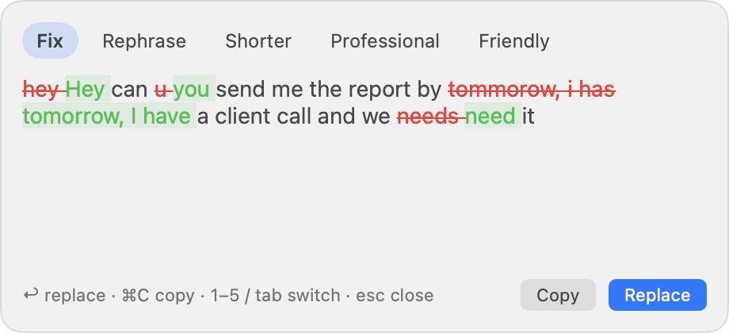

# On-Device Rephrase

A Grammarly-style writing helper that works in **every app**: select text (or just type in a text box),
press a hotkey or click the ✨ icon, and pick a rewrite — **Fix · Rephrase · Shorter · Professional · Friendly**.

- **Mac:** runs on Apple's **on-device** model — free, offline, no account. Optional Claude or ChatGPT.
- **Windows & Linux:** uses **your own Claude or ChatGPT login** (through their official CLIs), or a free local model via Ollama.
- **No API keys.** Rephrase never sees or stores your login.

<p align="center"></p>

## Install

**macOS** (macOS 26+, Apple Silicon)

```bash
curl -fsSL https://raw.githubusercontent.com/kiranvm143/On-Device-Rephrase/main/install/install.sh | bash
```

Then allow Rephrase in **System Settings → Privacy & Security → Accessibility** when asked.

**Windows** (PowerShell)

```powershell
irm https://raw.githubusercontent.com/kiranvm143/On-Device-Rephrase/main/install/install.ps1 | iex
```

**Linux** (X11 recommended; see [Wayland](#linux-on-wayland))

```bash
curl -fsSL https://raw.githubusercontent.com/kiranvm143/On-Device-Rephrase/main/install/install.sh | bash
```

Prefer a download? Tagged versions attach ready-to-run apps on the
[Releases](https://github.com/kiranvm143/On-Device-Rephrase/releases) page.

All installers start Rephrase right away and set it to start when you log in.

## Use

| | Mac | Windows / Linux |
|---|---|---|
| Open the popup | Click the ✨ icon in a text box, or select text and press **⌃⌥R** | Select text and press **Ctrl+Alt+R** |
| Switch rewrite | `1`–`5` or `Tab` | `1`–`5` or `Tab` |
| Replace your text | `↩` | `Enter` |
| Copy instead | `⌘C` | `Ctrl+C` |
| Close | `esc` | `Esc` |
| Change engine | Menu-bar icon → Engine | Tray icon → Engine |

On Mac, if the icon covers something, press and hold it and drag it away; the spot is remembered per app.

## Engines

| Engine | Platforms | Setup | Cost |
|---|---|---|---|
| **Apple on-device** (default on Mac) | Mac | Turn on Apple Intelligence | Free, offline |
| **Claude** | All | Install [Claude Code](https://claude.com/product/claude-code), run `claude` once and sign in | Your Claude plan |
| **ChatGPT** | All | `npm i -g @openai/codex`, then `codex login` and sign in with ChatGPT | Your ChatGPT plan |
| **Local (Ollama)** | Windows, Linux | Install [Ollama](https://ollama.com), then `ollama pull llama3.2` | Free, offline |

**How the Claude and ChatGPT logins work:** Rephrase runs the official `claude` or `codex` program already on your
computer, in a no-tools, text-only mode, and reads its answer. You sign in to those programs yourself; Rephrase never
touches your credentials or tokens. Please check that this use fits your plan's terms — Anthropic, for example,
intends Claude subscription logins for its own apps, and an API key is the supported route for heavy or shared use.

## Privacy

- With the Apple or Ollama engine, your text never leaves your computer.
- With Claude or ChatGPT, the text you rewrite is sent to that service, as if you'd pasted it into their app.
- Rephrase skips password fields, terminals and password managers. Logs record lengths, never your text.
- On Mac, for apps like Zoom that hide their text boxes, Rephrase notes *that* you're typing (never which keys)
  to place the icon.

## Linux on Wayland

Wayland blocks global hotkeys and simulated typing. Rephrase still works through the clipboard:

1. Add a keyboard shortcut in your desktop settings that runs `rephrase --trigger`.
2. Copy text (Ctrl+C), press your shortcut, pick a rewrite.
3. Press Enter — the rewrite is copied — then paste it (Ctrl+V).

## Uninstall

- **Mac:** quit from the menu-bar icon, delete `~/Applications/Rephrase.app`, and remove it from Login Items.
- **Windows:** delete `%LOCALAPPDATA%\Rephrase` and the Rephrase shortcuts in the Start Menu and Startup folders.
- **Linux:** `rm -rf ~/.local/share/rephrase ~/.local/bin/rephrase ~/.config/autostart/rephrase.desktop ~/.local/share/applications/rephrase.desktop`

## Build from source

```bash
git clone https://github.com/kiranvm143/On-Device-Rephrase.git && cd On-Device-Rephrase

# Mac (needs Xcode Command Line Tools with the macOS 26 SDK)
./macos/build.sh                      # builds and installs ~/Applications/Rephrase.app
~/Applications/Rephrase.app/Contents/MacOS/Rephrase --test "i has went their" fix apple

# Windows / Linux
pip install ./desktop
rephrase --test "i has went their" claude fix
```

### Layout

| Path | What's there |
|---|---|
| `macos/` | Native Swift menu-bar app: Accessibility text-box detection, floating icon, hotkey, popup, engines |
| `desktop/` | Python app for Windows and Linux: tray icon, hotkey, popup, engines |
| `install/` | One-line installers (`install.sh` for Mac/Linux, `install.ps1` for Windows) |
| `.github/workflows/` | CI on Windows/Linux, and release builds when you push a `v*` tag |

### Troubleshooting

- **Mac:** `~/Library/Logs/Rephrase.log` explains what the icon sees in each app. To see why an app's text box
  isn't detected: `open -n -a Rephrase --args --probe <bundle-id>`, switch to that app within 8 seconds, and read
  `~/Library/Logs/Rephrase-probe.txt`.
- **Windows / Linux:** `rephrase.log` next to `config.json` (`%APPDATA%\Rephrase` or `~/.config/rephrase`).

## License

MIT
