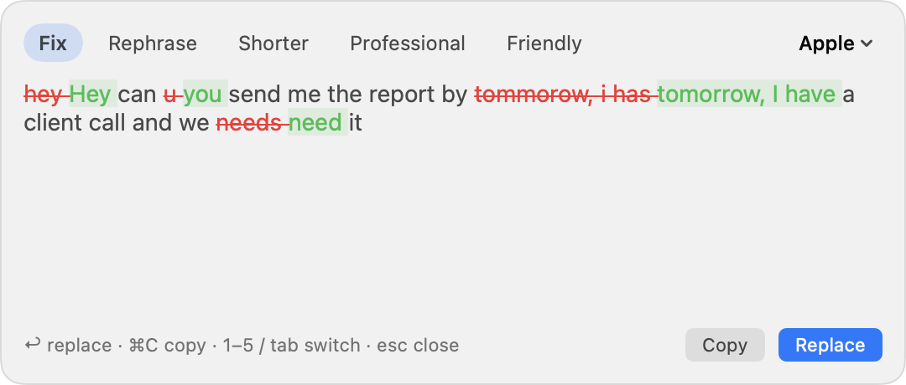
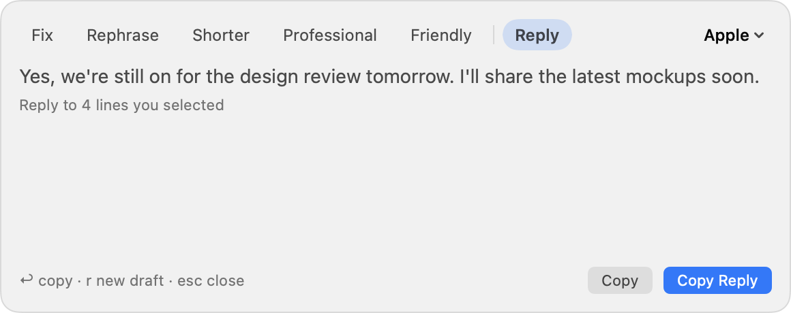
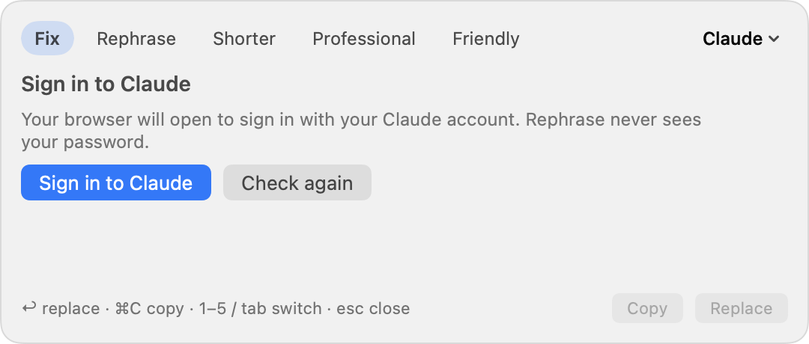

# Rephrase User Guide

Rephrase fixes and rewrites your writing in any app: email, chat, documents, browsers, Teams, Zoom and more.
Select some text (or just type in a text box), open Rephrase, pick a rewrite, and press Enter to replace your text.
It can also draft a reply to the messages on screen in Teams, Slack, Zoom and other chat apps.

**Contents**

1. [Install](#1-install)
2. [First launch](#2-first-launch)
3. [Rewrite text](#3-rewrite-text)
4. [Draft a reply](#4-draft-a-reply)
5. [Choose an AI engine](#5-choose-an-ai-engine)
6. [The menu-bar and tray menus](#6-the-menu-bar-and-tray-menus)
7. [Settings](#7-settings)
8. [Privacy](#8-privacy)
9. [Troubleshooting](#9-troubleshooting)
10. [Update and uninstall](#10-update-and-uninstall)
11. [FAQ](#11-faq)

---

## 1. Install

| Your computer | What you need |
|---|---|
| **Mac** | macOS 26 or later, Apple Silicon (M1 or newer). Apple Intelligence on, for the free on-device engine. |
| **Windows** | Windows 10 or 11. The installer offers to install Python if it's missing. |
| **Linux** | Python 3.9+, and an X11 session for the hotkey (Wayland works through the clipboard; see [Linux on Wayland](#linux-on-wayland)). |

### Option A: one-line install (recommended)

Open **Terminal** (Mac/Linux) or **PowerShell** (Windows), paste the line for your system, and press Enter.

**Mac and Linux**

```bash
curl -fsSL https://raw.githubusercontent.com/kiranvm143/On-Device-Rephrase/main/install/install.sh | bash
```

**Windows**

```powershell
irm https://raw.githubusercontent.com/kiranvm143/On-Device-Rephrase/main/install/install.ps1 | iex
```

The installer downloads Rephrase, installs it, starts it, and sets it to start when you log in.

- **Mac:** it builds the app on your Mac (about a minute) and puts it in the Applications folder in your home folder.
  If the Mac developer tools aren't installed, it downloads the ready-made app instead.
- **Linux:** if a system package is missing, it prints the exact `sudo apt install …` (or `dnf` / `pacman`) line to
  run, then you run the installer again.

### Option B: download the app

Download the file for your system from the
[latest release](https://github.com/kiranvm143/On-Device-Rephrase/releases/latest). These apps aren't signed by
Apple or Microsoft yet, so the first launch needs one extra step:

| File | First launch |
|---|---|
| `Rephrase-macOS.zip` | Unzip, move **Rephrase.app** to Applications and open it. When macOS blocks it, open **System Settings → Privacy & Security** and click **Open Anyway**. |
| `Rephrase-Windows.exe` | Run it. If SmartScreen appears, click **More info → Run anyway**. |
| `Rephrase-Linux-x86_64` | `chmod +x Rephrase-Linux-x86_64 && ./Rephrase-Linux-x86_64` (needs `xclip` and `xdotool`). |

The downloaded apps don't set up start-at-login. On Mac you can turn it on from the menu (**Open at Login**).

---

## 2. First launch

### Mac

1. Rephrase appears as a small icon in the **menu bar** at the top right of your screen.
2. macOS asks to give Rephrase **Accessibility** access. Click **Open System Settings** and turn on **Rephrase**.
   Rephrase needs this to read the text you select and put the rewrite back. If you missed the prompt, click the
   menu-bar icon → **Accessibility: not allowed — click to open Settings**.
3. That's it. The free **Apple on-device** engine is ready if Apple Intelligence is on
   (**System Settings → Apple Intelligence & Siri**).

### Windows and Linux

1. Rephrase appears as a blue **R** in the system tray (Windows: bottom right, maybe under the **^** arrow).
2. Pick an engine the first time you open the popup (see [Choose an AI engine](#5-choose-an-ai-engine)).
   Windows and Linux have no built-in AI, so you'll use ChatGPT, Claude, or the free local Ollama.

---

## 3. Rewrite text

### Open the popup

| | Mac | Windows / Linux |
|---|---|---|
| **Click the ✨ icon** | Appears at the edge of the text box you're typing in | — |
| **Hotkey** | Select text, press **⌃⌥R** (Control + Option + R) | Select text, press **Ctrl + Alt + R** |
| **From the menu** | Menu-bar icon → **Rephrase or Reply** | Tray icon → **Rephrase Selection** |

On Mac, if nothing is selected, Rephrase uses everything in the text box.



### Pick a rewrite

| Mode | What it does |
|---|---|
| **Fix** | Corrects spelling, grammar, punctuation and capitalization and keeps your wording. Shows what changed: removed words in red, new words in green. |
| **Rephrase** | Says the same thing with different wording. |
| **Shorter** | Cuts filler and repetition, keeps every important fact. |
| **Professional** | Clear and polite, for work email or chat. |
| **Friendly** | Warm and relaxed. |

### Keyboard shortcuts in the popup

| Action | Mac | Windows / Linux |
|---|---|---|
| Replace your text with the rewrite | `↩` | `Enter` |
| Copy the rewrite instead | `⌘C` | `Ctrl+C` |
| Switch mode | `1`–`6`, or `Tab` / `Shift+Tab` | `1`–`6`, or `Tab` / `Shift+Tab` |
| Try the same mode again (or a new reply draft) | `r` | `r` |
| Close | `esc`, or click anywhere else | `Esc`, or click anywhere else |

Replacing and copying don't overwrite what you had on the clipboard: Rephrase puts it back afterwards.

### The ✨ icon (Mac)

- It appears when the cursor is in a text box that has some text in it (in chat apps, also when the box is empty, for
  [replies](#4-draft-a-reply)), and hides in password fields, terminals and password managers.
- **Move it:** if it covers a button, press and hold it, then drag it anywhere. Rephrase remembers the spot for each
  app. To put every icon back: menu-bar icon → **Reset Icon Positions**.
- **Turn it off:** menu-bar icon → **Show Icon in Text Boxes**. The hotkey still works.
- **Zoom:** Zoom hides its chat box from other apps, so there the icon appears just above where you clicked, once you
  start typing. Clicking it uses the whole message.

---

## 4. Draft a reply

Rephrase can read the last messages in a conversation and write your answer. It never sends anything: the reply goes
into the message box (or onto the clipboard) and you decide whether to send it.



### Mac

1. Click into the message box in Teams, Slack, Zoom, Messages, WhatsApp or another chat app (or a reply box in your
   browser).
2. Click the ✨ icon, or press **⌃⌥R**. With an empty box, the popup opens on **Reply** and drafts an answer to the
   messages on screen.
3. Press **↩** to put the draft in the message box, `r` for a different draft, or `esc` to close. Then edit it and
   send it as usual.

**Tell it what to say.** Type a few words first, like `yes but next week`, then open the popup and pick **Reply**
(or press `6`). Rephrase turns your notes into a full reply to the conversation.

**Reply to specific messages.** Select the messages you want to answer and press **⌃⌥R**. In chat apps the popup
opens on **Reply**; press **↩** to copy the draft, then click the message box and press **⌘V**.

**How Rephrase reads the conversation.** It reads the messages visible above the message box, in that box's column
(so the channel list and other panes are left out), up to about the last 4,000 characters.

- Most apps (Teams, Slack, Messages, WhatsApp, browsers) share their text with Accessibility, the permission
  Rephrase already has.
- **Zoom** hides its messages, so there Rephrase reads the text visible in the window instead, with Apple's
  on-device text recognition. The first time, the popup asks you to allow **screen reading**: click
  **Allow Screen Reading…**, turn on **Rephrase** under **Screen & System Audio Recording**, and press **⌃⌥R** again
  (if it still asks, click **Reopen Rephrase**). In Zoom, click into the message box and type something first so
  Rephrase knows where the box is, or select the messages instead.

### Windows and Linux

Rephrase can't read other apps' messages there yet, so you choose them:

1. Select the messages you want to answer and press **Ctrl + Alt + R**.
2. Click **Reply** (or press `6`).
3. Press **Enter** to copy the draft, then click the message box and press **Ctrl+V**.

### Tips

- Drafts match the conversation's language and tone and are kept short, like a normal chat message.
- Rephrase doesn't know your plans, so drafts avoid making promises or claims for you. Where a detail is needed, they
  leave a placeholder like `[time]` for you to fill in.
- Your name tells Rephrase which messages are yours (on Mac, the name of your user account).

---

## 5. Choose an AI engine

Click the engine name at the **top right of the popup** (for example **Apple ⌄**) and pick one. Your choice is
remembered. Engines that aren't ready show what's missing, such as "— sign in" or "— not installed".

| Engine | Where | Cost | Speed | Your text goes to |
|---|---|---|---|---|
| **Apple on-device** | Mac | Free | Under 1 s | Nowhere: it stays on your Mac |
| **ChatGPT** | All | Your ChatGPT plan | ~8–10 s | OpenAI |
| **Claude** | All | Paid Claude plan (Pro, Max, Team/Enterprise with Claude Code) | A few seconds | Anthropic |
| **Local model (Ollama)** | All | Free | Depends on your computer | Nowhere: it stays on your computer |

### Setting up an engine

If the engine you pick isn't ready, the popup shows what to do with one button. Press it (or press Enter):



| Engine | What you'll see |
|---|---|
| **ChatGPT** | Usually nothing: the first rewrite downloads a helper from OpenAI (about 100 MB, once) with a progress bar. If you've never signed in, click **Sign in with ChatGPT**; your browser opens to sign in. |
| **Claude** | **Install Claude Code** (about a minute), then **Sign in to Claude** in your browser. |
| **Ollama** | **Install Ollama**, then **Start Ollama**, then **Download model** (about 2 GB, once, with a progress bar). On Linux, Install opens Ollama's download page. |
| **Apple** | If Apple Intelligence is off, **Open System Settings** takes you there. |

After setup, the popup tries again automatically. If it closed while you were signing in, a short
"… is ready ✓" message appears; open Rephrase again to use it.

Click **Check again** at any time to re-check an engine.

> **About your logins:** Rephrase never asks for or sees your password. ChatGPT and Claude sign-ins happen in your
> browser, through OpenAI's and Anthropic's own tools, and Rephrase only asks those tools for a rewrite.

---

## 6. The menu-bar and tray menus

### Mac menu bar

| Item | What it does |
|---|---|
| **Rephrase or Reply (⌃⌥R)** | Opens the popup for the selected text, or for a reply in an empty message box |
| **Show Icon in Text Boxes** | Turns the ✨ icon on or off |
| **Reset Icon Positions** | Puts icons you dragged back in their default spot |
| **Open at Login** | Starts Rephrase when you log in |
| **Accessibility: allowed ✓** | Shows whether Rephrase has permission; click to open Settings |
| **Screen reading for replies** | Whether Rephrase may read the screen, needed only for replies in Zoom; click to allow it |
| **Engine** | Chooses the engine (same as the popup's picker) |
| **Quit Rephrase** | Quits |

### Windows / Linux tray

| Item | What it does |
|---|---|
| **Rephrase Selection** | Opens the popup for the selected text |
| **Engine** | Chooses the engine |
| **Open Settings File** | Opens `config.json` (see [Settings](#7-settings)) |
| **Quit Rephrase** | Quits |

---

## 7. Settings

Most settings are in the menus. A few extras:

### Windows and Linux: `config.json`

Open it from the tray icon → **Open Settings File**
(`%APPDATA%\Rephrase\config.json` on Windows, `~/.config/rephrase/config.json` on Linux). Restart Rephrase after
editing.

| Key | Default | Meaning |
|---|---|---|
| `engine` | first one available | `"claude"`, `"chatgpt"` or `"ollama"` |
| `hotkey` | `"<ctrl>+<alt>+r"` | The hotkey, e.g. `"<ctrl>+<shift>+space"` |
| `ollama_model` | `"llama3.2"` | Any model from [ollama.com/library](https://ollama.com/library) |
| `ollama_url` | `"http://localhost:11434"` | Where Ollama runs |
| `claude_model` | `"haiku"` | Claude model for rewrites (`haiku` is fastest) |

### Mac: Ollama model

The Mac app uses `llama3.2` by default. To use another model, run this once in Terminal, then pick
**Download model** in the popup:

```bash
defaults write com.local.rephrase ollamaModel qwen3:4b
```

### Linux on Wayland

Wayland doesn't let apps use global hotkeys or type into other apps. Rephrase works through the clipboard instead:

1. In your desktop's keyboard settings, add a shortcut that runs `rephrase --trigger`.
2. Copy text (**Ctrl+C**), press your shortcut, and pick a rewrite.
3. Press **Enter**: the rewrite is copied. Paste it with **Ctrl+V**.

---

## 8. Privacy

- **Apple on-device** and **Ollama** never send your text anywhere.
- **ChatGPT** and **Claude** send only the text you're rewriting to OpenAI or Anthropic, as if you'd pasted it into
  their apps, under your account and their privacy terms. For a reply, that's the messages Rephrase read (the ones
  visible on screen, or the ones you selected), so use Apple on-device or Ollama for conversations that must stay
  private.
- To draft a reply, Rephrase reads the conversation only when you ask for a reply, keeps it only while the popup is
  open, and never saves it. Screen reading (Zoom) happens on your Mac.
- Rephrase skips password fields, terminals and password managers.
- Logs record what happened (for example "AXTextArea 62 chars"), never your text.
- On Mac, for apps like Zoom that hide their text boxes, Rephrase notes *that* you're typing, never which keys.
- Your clipboard is restored after every replace or copy.

---

## 9. Troubleshooting

| Problem | Fix |
|---|---|
| **Mac: nothing happens on ⌃⌥R / no ✨ icon** | Menu-bar icon: does it say **Accessibility: allowed ✓**? If not, click it and turn Rephrase on. If the switch is on but it still says "not allowed", remove Rephrase from the list with **−**, then add it again with **+** (it's in the Applications folder in your home folder). |
| **"Select some text first"** | Select the text before pressing the hotkey. On Mac you can also just click into the text box. |
| **Mac: icon doesn't show in one app** | Some apps don't tell macOS where their text boxes are (Google Docs, for example). Select the text and press **⌃⌥R** instead: it works through copy and paste. |
| **Apple: "Turn on Apple Intelligence"** | **System Settings → Apple Intelligence & Siri**, turn it on, and wait for the model to download. |
| **Claude asks you to upgrade** | Claude Code needs a paid Claude plan. Use ChatGPT, Apple or Ollama instead. |
| **ChatGPT: "Sign in with ChatGPT"** | Click it and sign in in your browser. If the browser doesn't open, a Terminal window opens instead; finish there. |
| **ChatGPT is slow** | About 8–10 s per rewrite is normal. Use Apple on-device for quick fixes. |
| **Ollama: "isn't running"** | Click **Start Ollama**, or open the Ollama app yourself. |
| **Windows: popup doesn't take keystrokes** | Click inside the popup once, or use its buttons. |
| **Linux: hotkey does nothing** | You may be on Wayland; see [Linux on Wayland](#linux-on-wayland). Otherwise check `xclip` and `xdotool` are installed. |
| **Rewrite looks wrong** | Try another mode, press `r` to retry, or switch engine. |
| **Reply: "Couldn't find any messages"** | The app didn't share its messages. Select the messages you want to answer, press **⌃⌥R** and choose **Reply**. |
| **Reply: "Allow screen reading" keeps showing** | Turn on Rephrase in **System Settings → Privacy & Security → Screen & System Audio Recording**, then click **Reopen Rephrase**. |
| **Reply answers the wrong part of the chat** | Scroll so the messages you're answering are visible, or select just those messages. |

### Logs

If something still doesn't work, the log shows each step (never your text):

- **Mac:** `~/Library/Logs/Rephrase.log`
- **Windows:** `%APPDATA%\Rephrase\rephrase.log`
- **Linux:** `~/.config/rephrase/rephrase.log`

Please include the last lines in an [issue](https://github.com/kiranvm143/On-Device-Rephrase/issues).

---

## 10. Update and uninstall

**Update:** run the [install command](#option-a-one-line-install-recommended) again. Your settings and, on Mac, your
Accessibility permission are kept.

**Uninstall:**

| | Steps |
|---|---|
| **Mac** | Menu-bar icon → **Quit Rephrase**. Delete **Rephrase** from the Applications folder in your home folder. Optionally delete `~/Library/Application Support/Rephrase` (Rephrase's ChatGPT helper) and `~/Library/Logs/Rephrase.log`. |
| **Windows** | Tray icon → **Quit Rephrase**. Delete `%LOCALAPPDATA%\Rephrase`, `%APPDATA%\Rephrase`, and the **Rephrase** shortcuts in the Start Menu and Startup folders. |
| **Linux** | Tray icon → **Quit Rephrase**, then run: `rm -rf ~/.local/share/rephrase ~/.local/bin/rephrase ~/.config/rephrase ~/.config/autostart/rephrase.desktop ~/.local/share/applications/rephrase.desktop` |

Uninstalling Rephrase doesn't sign you out of ChatGPT or Claude, or remove Ollama or Claude Code.

---

## 11. FAQ

**Do I need an API key?**
No. Use Apple on-device or Ollama for free, or your existing ChatGPT or Claude account.

**Why can't I just sign in with my ChatGPT or Claude website login?**
OpenAI and Anthropic don't let other apps use their website logins. Rephrase uses their official tools instead,
which sign in through your browser.

**Is it really free?**
Rephrase is free and open source (MIT). Apple on-device and Ollama are free. ChatGPT and Claude use your plan with
those companies.

**Does it work offline?**
Yes, with Apple on-device or Ollama.

**Which engine should I use?**
Apple on-device for fast everyday fixes. ChatGPT or Claude when tone and wording matter most. Ollama if you want free
and private on Windows or Linux.

**Does Rephrase send replies for me?**
No. It only drafts them. You always review, edit and send the message yourself.

**Can I change the hotkey?**
On Windows and Linux, yes: set `hotkey` in `config.json`. On Mac it's fixed at ⌃⌥R for now.
